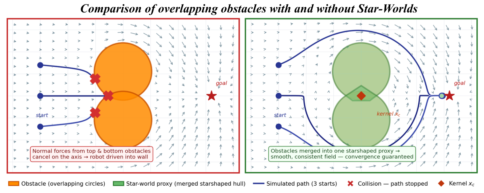

# Star-Worlds: Reactive 3D Motion Planning for a Franka Arm

**MEAM 6230 Final Project — University of Pennsylvania, Spring 2026**  
Gia D'Costa · Saayuj Deshpande · Samhitha Vedire

Implementation of **"Creating Star Worlds: Reshaping the Robot Workspace for Online Motion Planning"** — Dahlin & Karayiannidis, *IEEE Transactions on Robotics* 39(5), 2023. ([DOI](https://doi.org/10.1109/TRO.2023.3279029))

---

## Overview

Reactive motion planners based on modulation (Huber et al.) require obstacles to be **disjoint** and **star-shaped**. In cluttered scenes, overlapping inflated obstacles violate this. Their competing modulations can cancel and trap the robot.

This project extends the Star-Worlds algorithm to the **3-D end-effector workspace** of a Franka Panda in PyBullet:

1. **Star-world reshaping (Algorithm 2, 3-D):** clusters intersecting obstacles into disjoint star-shaped proxies. The kernel is selected with an exact 3-D admissibility test, so the robot and goal stay outside every proxy. Selection also uses temporal coherence, a workspace-aware choice of side and a deadlock-triggered kernel flip.
2. **DS modulation:** Huber-style modulation `M = E D E^-1` with a surface-tangent basis, evaluated on the exact star-shaped union, at 40 Hz.
3. **Whole-body velocity QP:** tracks the planned EE velocity while barrier constraints keep every Franka link clear of the perceived obstacles. The constraints use the robot's collision meshes.
4. **Obstacles:** spheres, boxes and cylinders, plus non-convex unions of them; static or continuously moving.

> **Journal revision (ROBOMECH Journal, 2026).** The code was substantially revised after review. See `experiments/` and the *Reproducing the paper* section. The submitted pipeline is still available as the methods `sw_legacy` and `mod_legacy`.

---

## Demo

**▶ [Watch the demo video](https://youtu.be/MY4ZFPl7pGw)** (recorded with the submitted version)

---

## Results (revised evaluation)

200 randomised trials per method (10 scenarios × 20 seeds, 180 s limit). Success means the goal was reached within 2 cm with no robot–obstacle penetration deeper than 5 mm on the Franka collision meshes.

| Method | Success | 95 % CI |
|---|---|---|
| **SW (star worlds, ours)** | **98.5 %** | [96, 99] |
| Convex-hull merging | 93.0 % | [89, 96] |
| Per-obstacle modulation | 88.5 % | [83, 92] |
| CBF-QP | 75.5 % | [69, 81] |
| APF | 46.0 % | [39, 53] |
| Submitted pipeline (SW-v1) | 51.5 % | [45, 58] |

Raw per-trial results are in `results/*.jsonl`. The paper also reports studies of the safety margin, perception noise, update rates, obstacle speed, computation time, path-length decomposition and an ablation.



---

## Setup

Requires Python ≥ 3.9.

```bash
git clone https://github.com/saayuj/star-worlds
cd star-worlds
python3 -m venv .venv
source .venv/bin/activate
pip install -r requirements.txt
```

---

## Running the demo

```bash
python examples/franka_pybullet_demo.py --scenario overlap                 # GUI, star worlds
python examples/franka_pybullet_demo.py --scenario overlap --method mod    # per-obstacle modulation
python examples/franka_pybullet_demo.py --scenario dynamic --headless      # no window
```

Scenarios: `single overlap wall simple moderate corridor dynamic boxes cylinders irregular`.
Methods: `sw sw_adaptive mod ch cbf apf sw_legacy mod_legacy`. In GUI mode, press **Enter** to start.

2-D illustrations: `python examples/2d_comparison.py`, `python examples/2d_static.py`.

---

## Reproducing the paper (all headless)

The exact version used for the ROBOMECH Journal article is tagged [`robomech-revision`](https://github.com/saayuj/star-worlds/tree/robomech-revision). `--suite all` includes the latency/asynchronous-execution study (`latency`).

```bash
python -m experiments.run_experiments --suite all --procs 14   # ~8 000 trials → results/*.jsonl
python -m experiments.run_experiments --suite noise2
python -m experiments.path_analysis 14                         # results/path_analysis.json
python -m experiments.timing_benchmark                         # results/timing.json (run alone)
python -m experiments.render_figures record                    # trajectories for rendered figures
python -m experiments.render_figures render                    # offscreen PyBullet renders
python -m experiments.make_figures all                         # figures + LaTeX tables
```

---

## Tests

```bash
pytest tests/ -q    # 61 tests
```

---

## Repository structure

```
starworlds/
├── shapes3d.py           # convex 3-D shapes via support functions (sphere, box, cylinder)
├── obstacles.py          # 2-D obstacles and Ellipsoid
├── geometry.py, geometry_3d.py
├── admissible_kernel.py  # 2-D admissible kernel, Eq. (6)–(9)
├── kernel_selection.py   # Algorithm 3 (2-D) and exact 3-D admissible-kernel selection
├── starshaped_hull.py    # starshaped hulls, 2-D and 3-D
├── star_world.py         # Algorithm 2 (2-D and 3-D)
├── integration.py        # StarWorldUpdater (temporal coherence, kernel flip)
├── reactive_controller.py# DS modulation (revised and legacy)
└── baselines.py          # per-obstacle / convex-hull proxies, CBF-QP, APF
experiments/
├── scenarios.py          # the 10 benchmark scenarios
├── sim_core.py           # headless simulator, whole-body QP, metrics
├── run_experiments.py    # batch runner (multiprocess, resumable)
├── path_analysis.py, timing_benchmark.py
├── render_figures.py     # offscreen posture overlays
└── make_figures.py       # figures and LaTeX tables
examples/                 # GUI demo and 2-D illustrations
results/                  # raw results (JSON lines)
```

---

## References

- Dahlin & Karayiannidis, "Creating Star Worlds," *IEEE T-RO* 39(5), 2023
- Huber, Billard & Slotine, "Avoidance of Convex and Concave Obstacles," *IEEE RA-L* 4(2), 2019
- Huber, Slotine & Billard, "Avoiding Dense and Dynamic Obstacles," *IEEE T-RO* 38(5), 2022
